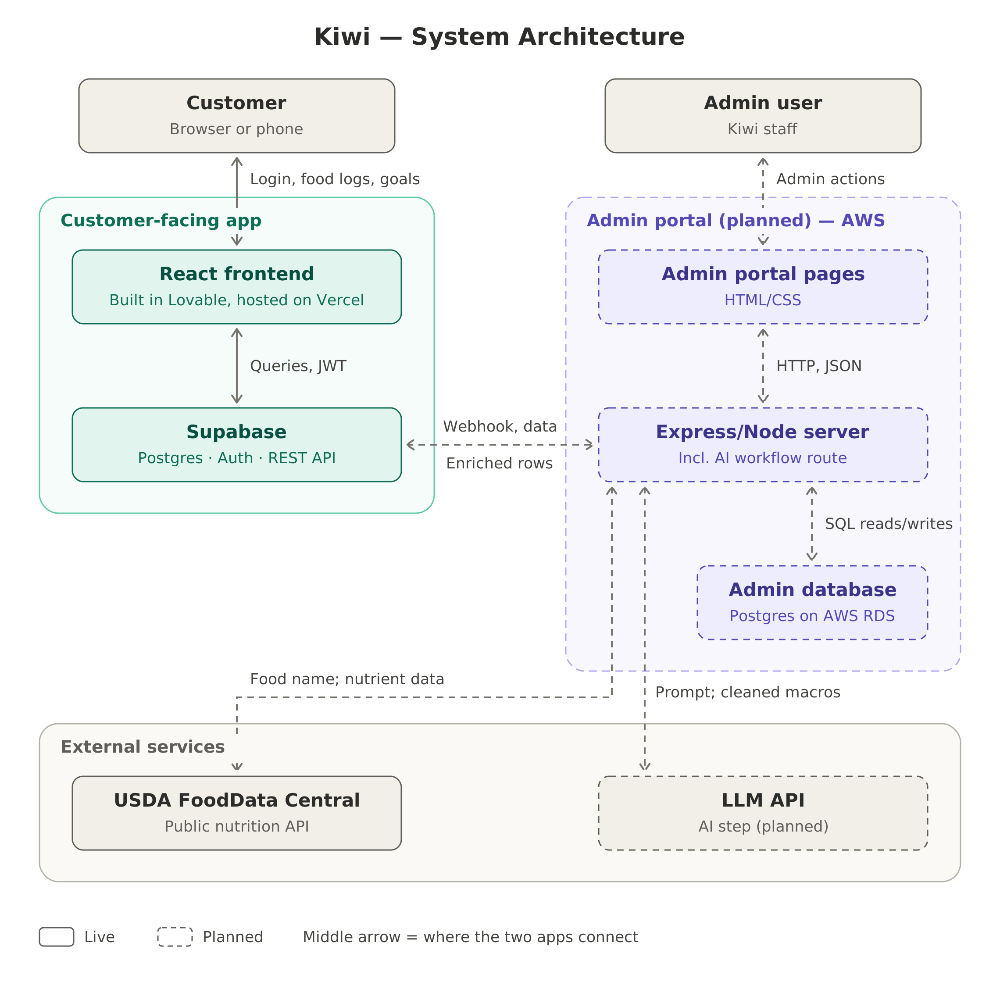

## Summary
Eat healthy, live happy.

Kiwi is an app that provides recommendations to users on how to eat healthier. 

The app displays nutrient information of foods you are already eating and gives recommendations on what to eat. It helps users identify nutritional gaps and makes plans to help close those gaps. This app also helps users to shop for healthier foods.

## ERD


## Tech Stack
- Frontend: React, TypeScript, Vite
- Application: TanStack Start and TanStack Router
- UI: Tailwind CSS and Radix UI
- Backend, authentication, and database: Supabase

## System Architecture Diagram


## How to run
### First time install (DEV)
```bash
git clone https://github.com/zinkozapper/projectKIWI
npm install
```

Copy the `.env` file from the example and add the Supabase values:

```bash
cp .env.example .env
vi .env
```

Start the app:

```bash
npm run dev
```

Open the local URL printed by Vite, usually `http://localhost:8080`.

### Lighthouse performance testing

Use the production build when testing Lighthouse; the development server includes HMR and development-only code that can distort performance results.

```bash
npm run build
npm run preview
```

Open the preview URL printed by Vite, usually `http://localhost:4173`, and run Lighthouse against that URL.

### Update app

Simply pull the latest repo then run it

```bash
git pull
npm run dev
```

### Verify vertical slice
On home page, fill out account information and select 'Create Account.' The app will send you an email to verify your account. Click on the link in the email and then you will be logged in! You can also select logout in the bottom left hand corner of the screen and log back in using the email and password you provided.

