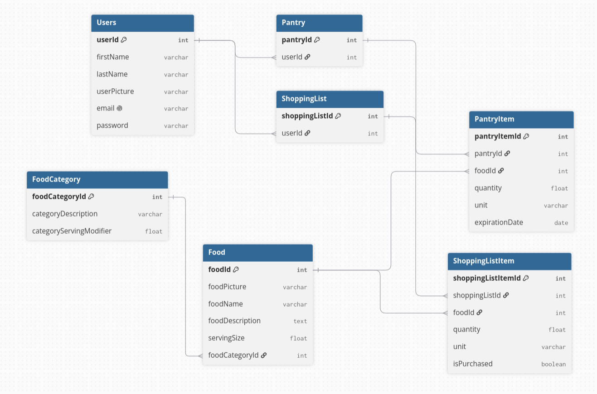
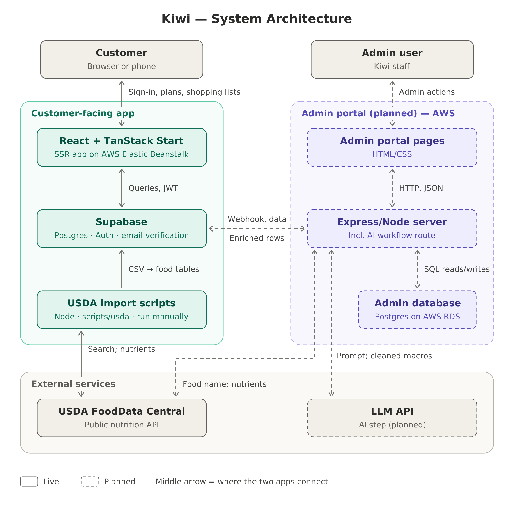
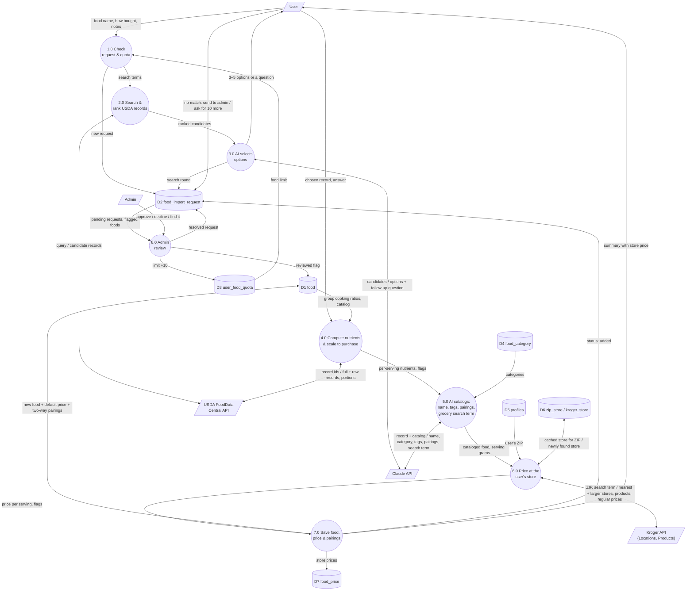

# Kiwi Nutrition

## Summary
Eat healthy, live happy.

Kiwi is an app that provides recommendations to users on how to eat healthier. 

The app displays nutrient information of foods you are already eating and gives recommendations on what to eat. It helps users identify nutritional gaps and makes plans to help close those gaps. This app also helps users to shop for healthier foods.

Kiwi is built for young adults planning groceries on a budget. Live site: **https://dfoo37gyp3r01.cloudfront.net**

## Features

- **Profile and daily targets.** Age, height (ft/in), weight (lb), sex, activity and goal set daily targets for 27 nutrients from adult NIH DRIs. Height and weight are stored as cm/kg; a ZIP code is used for local price estimates.
- **First-session onboarding** (`/onboarding`). New accounts see a welcome screen, then go to the pantry to add foods already at home or skip to planning. During the first authenticated session, the default-estimates notice, budget summary and pantry-check prompts are hidden. Users without a profile see the default-estimates notice in later sessions. The session lasts until sign-out or expiration; refreshing the session token does not end it.
- **My plan** (`/plan`). Use **Add to list** to search the catalog in a popup and build a grocery trip. Each add puts 1 serving per day on the list for the whole trip. Nutrient bars show what the pantry already covers and what the list adds. Suggestions rank foods by how much of your gaps they fill per dollar, and "Pairs well with" suggests foods that go together.
- **Budget periods.** The budget is an amount per 1, 2 or 4 weeks that repeats from a start date, so spending resets on its own each period (`src/lib/budget-period.ts`, migration 0006).
- **Persistent pantry** (`/plan/pantry`). Foods stay in the pantry until you mark them gone. Finishing a trip adds everything bought. After the first session, a **pantry check** asks what's still at home before a new plan starts (`src/lib/pantry-check.ts`); adding a past list explicitly includes its items.
- **Shopping mode** (`/plan/shop`) lets users check items off in the store. Finishing a trip opens **Past Trips** (`/plan/history`), which shows completed lists and estimated item prices; users can rename or delete trips and add their items to the current plan. Deletion can be undone for six seconds. Prices are current estimates, not historical receipts.
- **Food preferences** (`/food-preferences`) lets users manage liked and disliked foods, which influence recommendation ranking.
- **Local prices.** Kiwi uses store prices for the profile ZIP where available, identifies unknown prices and partial totals, and warns when a local price snapshot is stale. Prices are estimates, not guaranteed checkout prices.
- **AI food workflow.** Add foods that aren't in the catalog (see below).
- **Sign-in.** Email and password, passkeys (managed on `/profile`), and password reset. "Remember me" is on by default, so users stay signed in across browser restarts. Google sign-in is built but hidden until `VITE_GOOGLE_SIGN_IN=true` (it needs a Google Cloud OAuth client set up in Supabase first).
- **Theme.** Light by default, with dark mode and four color schemes on `/profile`. The choice is saved on the device and applied before the page paints.
- **Admin dashboard** (`/admin`). Only accounts in `public.app_admin` see the Admin button. It shows the OKR tiles, daily history, a user list with a Make admin button, and the queue of food requests and flagged foods from the AI workflow.

### OKR tracking

| OKR | What's measured | Migration | Queries |
|---|---|---|---|
| 1. Effective recommendations | Suggestions shown, added and dismissed (`recommendation_event`) | 0003 | [docs/recommendation-metrics.sql](docs/recommendation-metrics.sql) |
| 2. Nutrient goal achievement | Share of nutrient targets the pantry meets (`nutrient_profile_snapshot`) | 0007 | [docs/nutrient-goal-metrics.sql](docs/nutrient-goal-metrics.sql) |
| 3. Login frequency | Users with 2+ logon days in the last 30 days | 0005 | [docs/login-frequency.sql](docs/login-frequency.sql) |
| 4. Churn | Users active last 30 days with no activity this 30 days (`user_login_events`) | 0004 | [docs/churn-metrics.sql](docs/churn-metrics.sql) |

Daily snapshots are scheduled with `pg_cron` when it is enabled in Supabase (Database → Extensions). All four numbers also show on `/admin`.

## ERD


## Tech Stack
- Frontend: React, TypeScript, Vite
- Application: TanStack Start and TanStack Router
- UI: Tailwind CSS and Radix UI
- Backend, authentication, and database: Supabase
- AI and data: Claude API, USDA FoodData Central, Kroger API
- Hosting: AWS Elastic Beanstalk behind CloudFront, deployed by GitHub Actions

## System Architecture Diagram


## AI food workflow

Users can add foods that aren't in Kiwi's catalog. From the plan page, choose **Add to list**, search for a food, and choose **Can't find it? Add … to Kiwi**. The workflow connects the app to external services (USDA FoodData Central for nutrients, the Kroger API for store prices) with an AI step (Claude) in the middle, and a person makes the final choice:

1. **Request.** The user says what they want and how they buy it (fresh, dry, ready to eat or packaged). Each user can add 10 foods; an admin approves each further block of 10.
2. **Search.** The app's server searches USDA FoodData Central. Kiwi's selection rules ([docs/usda-record-selection-rules.md](docs/usda-record-selection-rules.md)) drop unusable records (for example cooked "fat added" versions) and order the rest by how many of Kiwi's 27 nutrients they report.
3. **AI picks options.** Claude chooses the 3–5 records that best match, explains each in one line, and asks a follow-up question when the request is ambiguous ("Brown, green or red lentils?"). It can only choose records USDA returned.
4. **User chooses.** The user picks an option (one click), answers the question, searches again, or sends the request to an admin. Everything after this is automatic.
5. **Kiwi computes the nutrients.** Code, not the AI, converts the record to what you buy, using the serving set by the food-group rules. For cooked foods it also finds the matching raw or dry record and uses the raw-to-cooked calorie ratio. It takes sodium from the raw record so cooking salt isn't counted, and compares the ratio with similar foods already in Kiwi.
6. **AI catalogs it.** Claude names the food and picks its emoji, category, flavor profile (from a fixed list of 16 tags) and pairings (only foods already in Kiwi). It also writes the grocery-store search term for the food. The server drops anything outside those lists.
7. **Priced.** The server looks up the user's ZIP (profile, default 84601 downtown Provo) and its nearest Kroger-family store (Smith's in Utah), searches it with Claude's term and picks a product with Kiwi's price rules ([docs/kroger-price-selection-rules.md](docs/kroger-price-selection-rules.md)): store brand, not organic, regular price, scaled to the same as-bought serving as the nutrients. If the store has nothing, up to 3 larger nearby stores are tried. The food is priced at the user's store and at the default store (`food.price`); no price never blocks adding the food.
8. **Saved.** The food is added for everyone, with pairings linked both ways so "Pairs well with" suggests it too. The user sees a summary and can add it to their list. If the food already exists, Kiwi uses the existing one. Foods the workflow wasn't sure about are flagged for an admin to double-check on `/admin`.

### Level 1 Data Flow Diagram



### Setup

The workflow runs in the app's own server (TanStack Start server functions in `src/lib/food-import/`). Keys stay on the server and never reach the browser. Add these to `.env` locally and to the Elastic Beanstalk environment (Configuration → Updates, monitoring, and logging → Environment properties):

| Variable | What it is |
|---|---|
| `FDC_API_KEY` | USDA FoodData Central key (free at https://api.data.gov/signup) |
| `ANTHROPIC_API_KEY` | Claude API key. `ANTHROPIC_MODEL` optionally overrides the default model (`claude-haiku-5-5`) |
| `SUPABASE_SERVICE_ROLE_KEY` | Supabase secret key; the server uses it to write foods after checking the user |
| `KROGER_CLIENT_ID`, `KROGER_CLIENT_SECRET` | Kroger API app (free at https://developer.kroger.com, Production environment, Products + Locations). Optional: without them new foods are saved unpriced |

The service-role key is required by the food finder in both the normal and Docker deployments. It bypasses RLS and must remain server-only; never put it in a `VITE_` variable. If the finder reports that it is missing, configure it in the app server's runtime environment, not just in the browser build.

The database side includes `drizzle/migrations/0009_kiwi_food_import_workflow.sql` and `0010_kiwi_localized_food_price.sql`; migrations 0012–0013 add price refresh and freshness tracking.

Prices for the existing catalog were loaded with the backfill script, which uses the same pricing code (`src/lib/food-import/pricing.ts`, `kroger.server.ts`): `node --env-file=.env scripts/kroger/1-search.mjs`, review `data/kroger/84601/candidates.csv`, then `node scripts/kroger/2-build.mjs` and run the generated SQL. Node 22.18+ is needed (it runs the TypeScript files directly).

For ongoing local-price refreshes, run `node --env-file=.env scripts/kroger/worker.mjs` as a separate long-lived process with `DATABASE_URL`, `KROGER_CLIENT_ID`, and `KROGER_CLIENT_SECRET` set. It processes queued ZIP codes, refreshes store snapshots at most every 30 days when current, and retries failures; without a running worker, queued price updates will not be processed. Database credentials and Kroger secrets must stay server-side.

The experimental self-hosted deployment uses an OpenAI-compatible provider rather than Claude; its configuration and limitations are documented in the [self-hosting guide](self-host/README.md).

## How to run

For the experimental Docker Compose deployment, see the [self-hosting guide](self-host/README.md).

### First time install (DEV)
You need Node 22 or newer.

```bash
git clone https://github.com/zinkozapper/projectKIWI
cd projectKIWI
npm install
```

If `npm install` fails with a peer dependency error, run `npm install --legacy-peer-deps`. On Windows PowerShell, if scripts are blocked, use `npm.cmd` in place of `npm` (for example `npm.cmd install`, `npm.cmd run dev`).

Copy the `.env` file from the example and add the Supabase values:

```bash
cp .env.example .env
vi .env
```

On Windows PowerShell: `Copy-Item .env.example .env`, then `notepad .env`.

`.env.example` only has placeholders, so the app shows a "can't load" page until you fill in the real `VITE_SUPABASE_URL` and `VITE_SUPABASE_PUBLISHABLE_KEY` (Supabase → Project Settings → API keys). The server-only keys in the [AI food workflow setup](#setup) are needed only for adding new foods. Optional: `VITE_GOOGLE_SIGN_IN=true` shows the Google button.

**Never commit `.env`.** It is gitignored on purpose and holds secret keys.

Start the app:

```bash
npm run dev
```

Open the local URL printed by Vite, usually `http://localhost:8080`.

### Tests

```bash
npm test
npm run test:watch
npm run lint
```

Lint currently reports existing formatting errors; avoid repo-wide formatting changes when working on unrelated files.

### Lighthouse performance testing

Use the production build when testing Lighthouse; the development server includes HMR and development-only code that can distort performance results.

```bash
npm run build
npm run preview
```

Open the preview URL printed by Vite, usually `http://localhost:4173`, and run Lighthouse against that URL.

### Update app

Simply pull the latest repo then run it

```bash
git pull
npm install
npm run dev
```

If anyone added a migration since your last pull, apply it in Supabase too (next section).

### Verify the app

After applying the migrations, create a new account at `/enroll` and follow the confirmation email if required. On the first sign-in, check that `/onboarding` leads to the pantry, where you can add foods or continue directly to the plan. Add foods to a list, finish a trip in shopping mode, and check that History opens and purchased foods appear in the pantry. Sign out and back in to check that the normal plan experience returns. Complete the optional profile to personalize nutrition targets.

## Database migrations

Migrations are plain SQL files in `drizzle/migrations/`. Nothing applies them automatically: run each new file, in order, in the Supabase SQL editor. After a schema change, regenerate `src/integrations/supabase/types.ts` instead of editing it by hand.

| File | What it adds |
|---|---|
| `0000_kiwi_profiles_and_grocery_lists.sql` | Profiles and the first grocery tables |
| `0001_kiwi_erd_schema.sql` | ERD schema: users, pantry, shopping lists, food catalog, RLS |
| `0002_kiwi_user_names.sql` | Fills first and last name on sign-up |
| `0003_kiwi_recommendation_events.sql` | OKR 1 recommendation events |
| `0004_kiwi_login_activity_churn.sql` | OKR 4 login events, `analytics` schema, churn snapshots |
| `0005_kiwi_login_frequency.sql` | OKR 3 login frequency |
| `0006_kiwi_budget_period.sql` | Budget period (1, 2 or 4 weeks) on profiles |
| `0007_kiwi_nutrient_goal_snapshots.sql` | OKR 2 nutrient goal snapshots |
| `0008_kiwi_admin_dashboard.sql` | `app_admin` and the admin dashboard functions |
| `0009_kiwi_food_import_workflow.sql` | AI food workflow: quotas, requests, review flags |
| `0010_kiwi_localized_food_price.sql` | Kroger stores and per-store food prices |
| `0011_kiwi_trip_name.sql` | Optional names for shopping trips |
| `0012_kiwi_price_refresh.sql` | Local-price refresh queue and store snapshots |
| `0013_kiwi_price_freshness.sql` | Catalog revisions and price freshness tracking |
| `0014_kiwi_first_session.sql` | Records new accounts' first authenticated session for onboarding |
| `0015_kiwi_saved_recipes.sql` | Recipes page: saved recipes, their ingredients and food groups |

The food catalog itself comes from the USDA scripts: import `data/usda/supabase/food_category.csv` before `data/usda/supabase/food.csv`.

Migration 0014 must be applied before creating accounts that should see onboarding; it does not backfill existing accounts. It creates triggers on `auth.users` and `auth.sessions`, so the database role applying it needs permission on those tables. If its session check is unavailable, the app logs an error and falls back to the regular plan experience.

To make the first admin, run this once in the SQL editor (after that, admins can make other admins from `/admin`):

```sql
INSERT INTO public.app_admin (user_id, note)
SELECT id, 'first admin' FROM auth.users WHERE email = 'you@example.com'
ON CONFLICT (user_id) DO NOTHING;
```

## Deployment

Every push to `main` deploys automatically. [.github/workflows/deploy.yml](.github/workflows/deploy.yml) installs with `npm ci --legacy-peer-deps`, builds with `NITRO_PRESET=node-server`, zips `.output` with a Procfile, and deploys it as a new version (`gh-<run>-<sha>`) to AWS Elastic Beanstalk (us-east-2, Node.js 22, application `kiwi-nitrition`, environment `Kiwi-nitrition-env`). You can also start it by hand from the Actions tab with **Run workflow**. The run fails if the environment ends up Red.

CloudFront serves the site over HTTPS at **https://dfoo37gyp3r01.cloudfront.net** in front of the Elastic Beanstalk URL. Share that address, not the EB one. Supabase Auth's Site URL and redirect URLs point to it.

**GitHub repository secrets** (Settings → Secrets and variables → Actions). The `VITE_` values are baked into the browser bundle at build time:

- `AWS_ACCESS_KEY_ID`, `AWS_SECRET_ACCESS_KEY`
- `VITE_SUPABASE_URL`, `VITE_SUPABASE_PUBLISHABLE_KEY`, `VITE_SUPABASE_PROJECT_ID`

**Elastic Beanstalk environment properties** (Configuration → Updates, monitoring, and logging → Environment properties). These are read by the server at runtime and never reach the browser:

- `SUPABASE_URL`, `SUPABASE_SERVICE_ROLE_KEY`
- `ANTHROPIC_API_KEY`, `FDC_API_KEY`
- `KROGER_CLIENT_ID`, `KROGER_CLIENT_SECRET`

The deployment workflow sets `VITE_GOOGLE_SIGN_IN=true` at build time; Google sign-in also requires the Google provider and OAuth client to be configured in Supabase.
