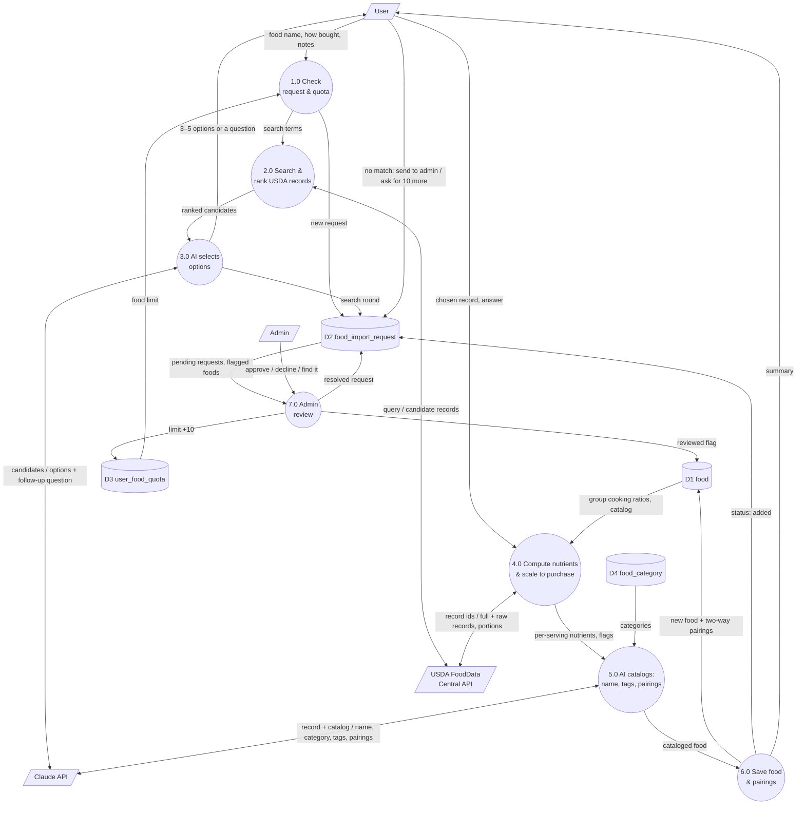

## Summary
Eat healthy, live happy.

Kiwi is an app that provides recommendations to users on how to eat healthier. 

The app displays nutrient information of foods you are already eating and gives recommendations on what to eat. It helps users identify nutritional gaps and makes plans to help close those gaps. This app also helps users to shop for healthier foods.

## ERD


## Tech Stack
- Frontend: React, TypeScript, Vite
- Application: TanStack Start and TanStack Router
- UI: Tailwind CSS and Radix UI
- Backend, authentication, and database: Supabase

## System Architecture Diagram


## AI food workflow

Users can add foods that aren't in Kiwi's catalog. From the plan page, search for a food and choose **Can't find it? Add … to Kiwi**. The workflow connects the app to an external service (USDA FoodData Central) with an AI step (Claude) in the middle, and a person makes the final choice:

1. **Request.** The user says what they want and how they buy it (fresh, dry, ready to eat or packaged). Each user can add 10 foods; an admin approves each further block of 10.
2. **Search.** The app's server searches USDA FoodData Central. Kiwi's selection rules ([docs/usda-record-selection-rules.md](docs/usda-record-selection-rules.md)) drop unusable records (for example cooked "fat added" versions) and order the rest by how many of Kiwi's 27 nutrients they report.
3. **AI picks options.** Claude chooses the 3–5 records that best match, explains each in one line, and asks a follow-up question when the request is ambiguous ("Brown, green or red lentils?"). It can only choose records USDA returned.
4. **User chooses.** The user picks an option (one click), answers the question, searches again, or sends the request to an admin. Everything after this is automatic.
5. **Kiwi computes the nutrients.** Code, not the AI, converts the record to what you buy, using the serving set by the food-group rules. For cooked foods it also finds the matching raw or dry record and uses the raw-to-cooked calorie ratio. It takes sodium from the raw record so cooking salt isn't counted, and compares the ratio with similar foods already in Kiwi.
6. **AI catalogs it.** Claude names the food and picks its emoji, category, flavor profile (from a fixed list of 16 tags) and pairings (only foods already in Kiwi). The server drops anything outside those lists.
7. **Saved.** The food is added for everyone, with pairings linked both ways so "Pairs well with" suggests it too. The user sees a summary and can add it to their list. If the food already exists, Kiwi uses the existing one. Foods the workflow wasn't sure about are flagged for an admin to double-check on `/admin`.

### Level 1 Data Flow Diagram



### Setup

The workflow runs in the app's own server (TanStack Start server functions in `src/lib/food-import/`). Keys stay on the server and never reach the browser. Add these to `.env` locally and to the Elastic Beanstalk environment (Configuration → Updates, monitoring, and logging → Environment properties):

| Variable | What it is |
|---|---|
| `FDC_API_KEY` | USDA FoodData Central key (free at https://api.data.gov/signup) |
| `ANTHROPIC_API_KEY` | Claude API key. `ANTHROPIC_MODEL` optionally overrides the default model (`claude-haiku-5-5`) |
| `SUPABASE_SERVICE_ROLE_KEY` | Supabase secret key; the server uses it to write foods after checking the user |

The database side is `drizzle/migrations/0009_kiwi_food_import_workflow.sql`.

## How to run
### First time install (DEV)
```bash
git clone https://github.com/zinkozapper/projectKIWI
npm install
```

Copy the `.env` file from the example and add the Supabase values:

```bash
cp .env.example .env
vi .env
```

Start the app:

```bash
npm run dev
```

Open the local URL printed by Vite, usually `http://localhost:8080`.

### Lighthouse performance testing

Use the production build when testing Lighthouse; the development server includes HMR and development-only code that can distort performance results.

```bash
npm run build
npm run preview
```

Open the preview URL printed by Vite, usually `http://localhost:4173`, and run Lighthouse against that URL.

### Update app

Simply pull the latest repo then run it

```bash
git pull
npm run dev
```

### Verify vertical slice
On home page, fill out account information and select 'Create Account.' The app will send you an email to verify your account. Click on the link in the email and then you will be logged in! You can also select logout in the bottom left hand corner of the screen and log back in using the email and password you provided.

